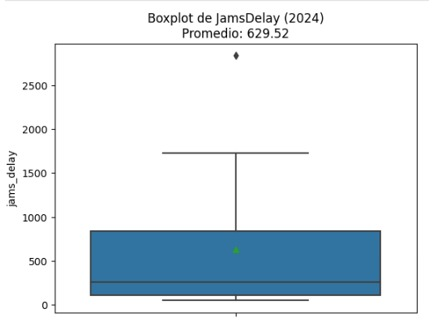
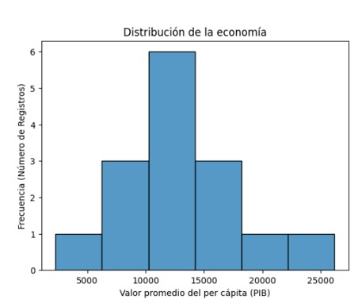
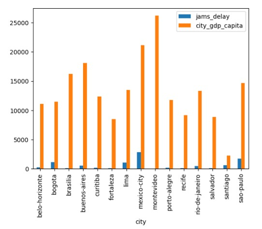

# Movilidad urbana y productividad económica en ciudades de Latinoamérica

## Descripción del proyecto

Análisis exploratorio desarrollado con Python para explorar la relación entre la congestión vehicular y los indicadores de productividad económica en ciudades de Latinoamérica durante 2024.

El proyecto integra información de movilidad urbana y variables económicas, con el propósito de identificar patrones, comparar indicadores y explorar posibles asociaciones entre las condiciones de tráfico y el desempeño económico de las ciudades.

## Objetivos

- Explorar el comportamiento de la congestión vehicular en diferentes ciudades.
- Analizar indicadores económicos, especialmente el PIB per cápita.
- Integrar información de movilidad y economía mediante variables comunes.
- Identificar patrones, distribuciones y posibles relaciones entre los indicadores.

## 📌 Resumen ejecutivo

El presente análisis exploratorio tuvo como objetivo examinar la relación entre la congestión vehicular y los indicadores económicos de 15 ciudades pertenecientes a 7 países de Latinoamérica durante 2024. Para ello, se integraron datos de movilidad urbana e indicadores económicos, utilizando variables como `jams_delay`, que representa los retrasos por tráfico, y `city_gdp_capita`, que permite aproximarse al nivel de actividad económica por habitante.

Los resultados muestran que `jams_delay` presenta una distribución sesgada hacia la derecha, con una media de **629,52** y una mediana de **263,05**. Esta diferencia evidencia la presencia de valores elevados que influyen en el promedio general. Ciudad de México registró el mayor retraso promedio (**2.833,06**), seguida de São Paulo (**1.729,19**) y Bogotá (**1.141,55**). Por su parte, la distribución del PIB per cápita mostró una mayor concentración de ciudades en rangos intermedios, aunque se identificaron algunos valores elevados y un dato correspondiente a Santiago que requiere validación adicional.

Al comparar los indicadores económicos y de movilidad, se observó una asociación positiva débil entre el PIB per cápita y los retrasos por tráfico. Esto sugiere que, en esta muestra, un mayor nivel de PIB per cápita no implica necesariamente mejores condiciones de movilidad. Sin embargo, los resultados no permiten establecer una relación causal ni concluir que la congestión determine el desempeño económico de una ciudad. También se identificaron limitaciones visuales al comparar ambas variables en un mismo gráfico de barras, debido a sus diferentes escalas de medición.

Como recomendación, Ciudad de México, São Paulo y Bogotá pueden considerarse ciudades prioritarias para investigaciones más detalladas sobre movilidad e infraestructura urbana, debido a sus elevados niveles de retraso por tráfico. Para profundizar en el análisis, sería conveniente incorporar variables adicionales, como población, densidad urbana, inversión en transporte público y características de la infraestructura vial. Finalmente, se recomienda validar los valores atípicos y contrastar las fuentes antes de utilizar estos resultados para decisiones estratégicas.

## Datos utilizados

Para el desarrollo de este proyecto se utilizaron dos conjuntos de datos proporcionados como parte del proyecto formativo de TripleTen:

- **TomTom Traffic:** información sobre congestión vehicular, tiempos de desplazamiento y retrasos.
- **OECD City Economy:** indicadores económicos y ambientales por ciudad, como PIB per cápita, desempleo, contaminación PM2.5 y población.

**Consideraciones sobre los archivos:** el conjunto de datos original de TomTom Traffic no se incluye en este repositorio debido a su tamaño. Por esta razón, se documenta su procedencia y se conserva el dataset final procesado utilizado en el análisis.

Los datos fueron utilizados con fines educativos y de análisis exploratorio.

## Herramientas y tecnologías

- Python
- Pandas
- NumPy
- Matplotlib
- Seaborn
- Jupyter Notebook

## Metodología

1. **Exploración de datos:** revisión de la estructura, columnas, tipos de datos y registros.
2. **Limpieza y transformación:** estandarización de nombres de columnas, conversión de fechas y formatos numéricos.
3. **Filtrado temporal:** selección de los registros correspondientes a 2024.
4. **Agregación:** cálculo de promedios de las métricas de tráfico por ciudad y año.
5. **Integración:** combinación de los conjuntos de datos mediante una unión INNER, utilizando ciudad y año como claves.
6. **Análisis exploratorio:** elaboración de gráficos para estudiar distribuciones, valores atípicos y posibles relaciones entre las variables.

## Principales hallazgos

- La variable `jams_delay` presenta una distribución sesgada a la derecha, con algunas ciudades que registran retrasos considerablemente superiores al resto.
- Ciudad de México presenta el mayor valor de retraso total promedio agregado entre las ciudades analizadas.
- El PIB per cápita presenta una distribución con mayor concentración de ciudades en rangos intermedios y algunos valores elevados.
- La comparación visual de las variables mostró que sus escalas son muy diferentes, por lo que un gráfico de barras con un mismo eje puede dificultar la interpretación.
- El análisis exploratorio no evidencia una relación clara y directa entre el PIB per cápita y la congestión vehicular.

## 📊 Visualizaciones del análisis

### 1. Distribución de los retrasos por tráfico

### 2. Distribución del PIB per cápita

### 3. Comparación de indicadores de movilidad y economía

## Limitaciones del análisis

El estudio comprende una muestra de 15 ciudades durante 2024, por lo que sus resultados no representan necesariamente el comportamiento de todas las ciudades latinoamericanas.

Los resultados describen patrones y posibles asociaciones; no permiten establecer relaciones de causalidad.

## Conclusión

Este proyecto permitió aplicar herramientas de análisis de datos para integrar, limpiar, transformar y explorar información de diferentes fuentes. Los resultados muestran la importancia de considerar tanto el comportamiento de las variables como la calidad de los datos y sus limitaciones al momento de interpretar los hallazgos.

Además, permitió fortalecer habilidades en Python, análisis exploratorio de datos, visualización y comunicación de resultados.
